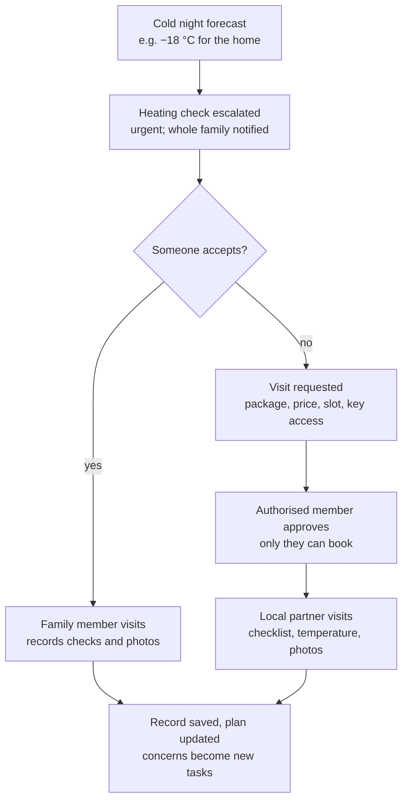
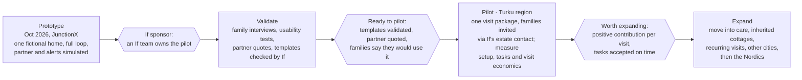

# If Home Watch — Venture brief

JunctionX Turku · If challenge "If Insurance Could Do More" · 2026-10-17

---

## 1. Summary

If Home Watch helps a family look after a parent's empty home after a death. It gives them a shared care plan, a named owner for every task, checks triggered by the weather, and an approved local visit when nobody can go.

**Customer promise:** "Know what needs attention, who is handling it, and how to get help when nobody can visit."

**Why If:** in Finland, If already learns of a death automatically, and its own terms already define how an empty home must be supervised. Home Watch turns those rules into practical help before anything goes wrong, instead of explaining them after a claim.

**What we ask If to test:** a pilot in one compact area (Turku region) with:

- task templates checked against the applicable If home-insurance terms
- one defined paid visit package delivered by a local partner
- measurement of setup completion, accepted tasks, paid-visit conversion and contribution per completed visit

**Pitch line:** "The family knows who is looking after the house, and can get help when nobody can go."

---

## 2. The problem

When a parent dies, their home becomes the family's responsibility overnight, and nobody tells them how to look after it. The estate inventory is due within three months. Homes often sit empty for months while heirs in other cities sort things out.

### What goes wrong

- **Nobody owns the house.** Each sibling assumes another will go. A reminder goes unanswered because nobody has accepted the task.
- **Nobody knows the house.** The family may not know where the water main valve is, how the heating works or whether a well pump needs frost protection.
- **The rules are in a policy PDF nobody reads.** If's home terms define building supervision as a visit at least monthly (§5). If the home is unoccupied for more than a week, the main valve must be closed and the domestic-water pump switched off (§5.5). In cold weather without enough basic heat, systems must be drained and the heating checked weekly. Neglecting protection instructions can affect compensation (§6.4.2). The terms version on the actual policy applies.
- **Paperwork crowds out the house.** Insurers can ask for a power of attorney from every heir, each on its own form ([KKV 528/2021](https://www.eduskunta.fi/FI/vaski/Kysymys/Documents/KKV_528+2021.pdf?lang=fi)).

### Evidence that it matters

- 59,209 people died in Finland in 2025, 942 more than in 2024 ([Statistics Finland](https://stat.fi/fi/julkaisu/cmfxn8721a75p07w3w9zrfp95)). Not every death leaves an empty home.
- UK Financial Ombudsman decisions show estates' water-damage claims refused under unoccupancy clauses ([DRN-5872511](https://www.financial-ombudsman.org.uk/decision/DRN-5872511.pdf)). Insurers widely treat empty homes as higher risk.
- From 1 Feb 2027 the state estate platform in OmaVero digitises the estate inventory, the heirs register and authorisations ([Vero](https://vero.fi/tietoa-verohallinnosta/uutishuone/verotuksen_muutoksia/kuolinpesan-asiointi-omaveroon-vuonna-2027/mita-kuolinpesan-asioinnin-uudistus-tarkoittaa-kuolinpesien-asioita-hoitaville-ammattilaisille/)). It covers paperwork only, nothing about the house itself.

---

## 3. Customer

The first customer is an adult child, or another authorised family member, responsible for a parent's home after a death. The pilot starts with confirmed-vacant detached and semi-detached houses in one local service area, where the family has to look after the whole building.

### Illustrative persona (fictional)

Aino, 46, lives in Helsinki. Her mother's detached house in Kaarina has been empty since late September. Her brother Mikko lives in Tampere. Aino handles the estate paperwork and has become the coordinator by default.

### What the family needs to get done

| Need | What success looks like |
| --- | --- |
| Keep the house safe until they decide what to do with it | No frozen pipes or unnoticed leaks; precautions done in the right order |
| Share the load fairly | Every urgent task has a named owner and a due date |
| Know what has been done | One shared view of visits, checks and open concerns |
| Get help when nobody can go | A priced, approved local visit, with access agreed |
| Keep a record | Who visited, when, what they checked, with photos |

### Not in the first version

- Homes where a surviving spouse or other resident still lives. Vacancy must be confirmed, never assumed from a death notice.
- Apartments where a housing company maintains the building (lower priority, possible later).

**Later segments:** a parent's move into care, a newly inherited cottage, other long absences.

---

## 4. Solution

Home Watch is a shared plan for one empty home that the whole family can see and act on. Its core is that every risk becomes a task with an owner, and a task nobody takes can become a paid local visit in a few taps.

### How it works

1. **Invite and confirm.** If offers Home Watch when the family contacts If about an estate, or through a verified contact. The family confirms the address, that nobody lives there, who coordinates and who can authorise access.
2. **Create the care plan.** A few questions about heating and water produce an ordered plan. Each task says why it matters and which policy section it comes from. Unknown details stay marked as unconfirmed.
3. **Assign responsibility.** Every urgent task has a named owner, a due time and a status. Family members accept a task or say they cannot do it. An unaccepted task stays visible to the coordinator.
4. **Build the house notes.** On the first visit, the family records where the water main valve, meter, fuse box and pumps are, with photos and useful contacts.
5. **Turn warnings into action.** A cold-night or storm forecast escalates the relevant check. The forecast does not prove what the indoor temperature is or that there is damage; it prompts a visit.
6. **Request a local visit.** If nobody can go, the coordinator sees the visit package, price, time slot and access options. Only an authorised family member can approve it.
7. **Record and share.** After each family or partner visit, the app stores who attended, when, what was checked, photos and open concerns. Concerns become new tasks.
8. **Close the loop at transition.** When the home is sold, distributed or lived in again, the plan closes and the new owner can get help arranging suitable cover. Staying with If is their choice.

### How a cold night is handled

A forecast only escalates the check. A visit, by family or partner, is what produces the record and updates the plan.

### What it deliberately is not

- Not a claim guarantee. The visit log records specific observations. It does not prove that every precaution was taken or that every loss is covered.
- Not a "safe home" badge or score.
- Not cold outreach triggered by a death notice alone.
- Not a sensor product. Devices are a possible later add-on.

---

## 5. Why If

If has three things no home-watch company or family app has: the moment, the rules and the customer relationship when the home changes hands.

| Advantage | What If already has | How Home Watch uses it |
| --- | --- | --- |
| The moment | If receives death information automatically in Finland ([estate guidance](https://www.if.fi/henkiloasiakkaat/asiakaspalvelu/usein-kysyttya/kuolinpesan-vakuutukset)) | Offer help when the family contacts If about the estate, before winter or a leak gets to the house first |
| The rules | If writes the supervision and protection instructions for empty homes ([home terms §5, §5.5, §6.4.2](https://www.if.fi/globalassets/fi/pdf/ehdot/kotivakuutusehdot.pdf)) | Turn the terms into a plain, ordered plan with reasons and sources |
| Risk knowledge | Claims data on what fails in empty homes: freezing, leaks, storms | Put the tasks that prevent the most damage first (to validate with If) |
| The transition | Estate property insurance can stay in the estate's name until distribution or sale; new owners must arrange their own | Help the heir who keeps or buys the home arrange suitable cover, if they choose |
| Service base | Maintenance plans and periodic inspections for eligible customers ([If Finland](https://www.if.fi/henkiloasiakkaat/vakuutukset/kotivakuutus/omakotitalo/omakotitalon-kunnossapitosuunnitelma)) and repair partner networks | A starting point for a vetted local visit partner |

A grieving family may also trust its existing insurer more than an unknown provider. That is a hypothesis to test in interviews, not an established fact.

---

## 6. Alternatives and differentiation

Each part of Home Watch exists somewhere. What is new is connecting the parts to the life event, the policy rules and practical help in one experience. We have not shown that nothing like it exists anywhere.

| Alternative | What it does | What it leaves out for this family |
| --- | --- | --- |
| Paid home-watch services, e.g. [HomewatchUSA](https://homewatchusa.com/vacant-home-monitoring-insurance/), [GulfShield](https://gulfshieldhomewatch.com/), [Snowbird Secure](https://snowbirdsecure.com/insurance/) | Inspect vacant homes and send photo reports | Family coordination, the life-event trigger, the link to the actual policy rules |
| Family cabin apps, e.g. [FamilyCottage](https://familycottage.app/), [Sharedstead](https://sharedstead.com/family-cabin-scheduling-app), [Cottage](https://getcottage.co/) | Scheduling and co-ownership for shared properties | A care plan, insurer rules, local help |
| Digital cottage book, e.g. [Supermökkiläinen](https://www.supermokkilainen.fi/supermokkilainen/) | House notes and instructions | Responsibility, visits, weather prompts |
| Estate notification, e.g. [Life Ledger, Settld](https://www.ataloss.org/FAQs/settld); the 2027 OmaVero estate platform | Notify companies; digitise estate paperwork | Anything about the physical home |
| [If Finland maintenance plan](https://www.if.fi/henkiloasiakkaat/vakuutukset/kotivakuutus/omakotitalo/omakotitalon-kunnossapitosuunnitelma) | Maintenance report, periodic inspection, advice | Built for occupied homes, not monthly supervision of an empty one |
| [If Norway Tryggere Hjem](https://www.if.no/privat/forsikring/bolig/tryggere-hjem) | Sensors, alarm centre, conditional deductible relief | Family responsibility and visits; a possible later add-on |

**What the prototype must prove:** that connecting the trigger, the plan, named owners and a bookable visit makes the family act sooner and miss fewer precautions than the separate parts would.

---

## 7. Business model

The shared plan is included and If charges for optional approved visits. Prevention, continuity and acquisition are the bigger benefits, but they need measuring over time. No price, commission or partner commitment has been validated yet.

### How If benefits

| Mechanism | Value for If | Evidence needed |
| --- | --- | --- |
| Optional paid visits | A transparent coordination fee on each approved visit | Willingness to pay, provider quotes, availability, real service costs |
| Prevention | Less avoidable damage in empty homes, or earlier detection | Baseline empty-home claims and a comparison measured over time |
| Customer continuity | The heir who keeps or buys the home arranges cover with If | Continuation rate compared with the existing estate process |
| Acquisition | Invited family members meet If through useful help | Voluntary conversion and acquisition cost |
| Service efficiency | Observations and completed checks are easy to find | Time saved for families and for If's service and claims staff |

### Prototype visit packages (placeholder prices, not quotes)

| Package | Scope | Partner price | If coordination fee | Customer pays |
| --- | --- | --- | --- | --- |
| Check visit | ~45 min: heating running, indoor temperature, signs of leaks, water main state, doors and windows, mail, photos | €59 | €10 | €69 |
| Winter-readiness visit | ~90 min: the check visit, plus water main and pump set as the family instructs, outdoor taps, snow seen from the ground | €95 | €15 | €110 |
| Urgent same-day check | The check visit within 24 hours, where available | €99 | €20 | €119 |

### Unit economics to measure in the pilot

- **Service revenue** = completed paid visits × If fee per visit
- **Contribution per visit** = If fee − (support + payment + service liability + share of acquisition cost)

Partner payments pass through and are not If revenue. Service revenue, insurance premiums and avoided claims are separate measures and are never added into one profit figure.

### Cross-market illustrations from our research (gross, middle case, every input an assumption)

| Lever | Assumption | Illustration |
| --- | --- | --- |
| Retention | Share of properties staying with If via an heir rises from 50% to 65%, ~€500/year each | ~€1.9M new recurring premium per yearly cohort |
| Acquisition | ~2.5 heirs per estate, 75% with other insurers, 5% switch, ~€1,000/year each | ~€2.3M new recurring premium per year |
| Claims avoided | 3% of empty estate homes claim (~€10k each), 40% of those prevented | ~€3M a year |

These assume ~25,000 If-insured estates a year across the seven If markets. They are gross premium volume and avoided claims, before acquisition, delivery and underwriting costs, overlap and churn. They are not a profit forecast.

---

## 8. Market

The trigger is frequent: about 59,000 deaths a year in Finland and about 330,000 across If's seven markets. Deaths are not the same as vacant homes, so the reachable market has to be measured in the pilot.

### Finland funnel

| Step | Count | Basis |
| --- | --- | --- |
| Deaths in Finland, 2025 | 59,209 | Statistics Finland |
| Leave an owned home or cottage | ≈ 29,600 | Assumption: about half |
| Home insured by If | ≈ 4,400 | Assumption: ~15% share |
| Left empty for months | Unknown | The pilot measures this |

**Across If's markets:** about 252,500 deaths a year in the Nordics and about 79,000 in the Baltics, roughly 900 a day. The same assumptions give ~25,000 If-insured estates a year (range 15,000–40,000). The Denmark and Norway figures are unchecked estimates.

**Rollout order: Finland, then the rest of the Nordics, then the Baltics.** The automatic death notice is verified only for Finland, and the 2027 heirs register covers Finland only.

---

## 9. Feasibility and operations

The software is straightforward. The hard parts are trustworthy visits, key access and correct care instructions, and those are what the pilot validates.

| Area | First version | What a real pilot adds |
| --- | --- | --- |
| Product | Web app: Next.js frontend and Next.js API on Vercel; Supabase database and photo storage | Strong electronic identification for family members and partners |
| Care instructions | Task templates written from If's published home terms, with section references | Templates checked by If for each policy version and home setup |
| Weather | Public forecast API for the home's location; a simulated cold night for the demo | FMI forecasts and warnings; thresholds agreed with If |
| Visits | One fictional partner, simulated booking and report | Contracts with local providers: scope, price, travel, availability, reporting, liability |
| Access and authority | The family confirms who can authorise access; only that person approves a booking | A verified authority check and a key-handover process (key holder meets the partner, key box, partner collects the key) |
| Trigger | A sample estate-support invitation link | An invitation when the family contacts If about an estate, using If's existing death information |
| Data | Notes and photos entered by the family; no confidential If data | Data-protection review, retention rules, photo ownership, deletion at transition |

**Scaling path:** templates per policy version and a partner per region, starting where routes are dense (Turku region: Kaarina, Lieto, Raisio), then other Finnish cities, then the Nordics.

---

## 10. Risks and mitigations

The biggest risks are adoption during grief and reliable visit delivery. Both are tested before any scale-up.

| Risk | Why it matters | Mitigation |
| --- | --- | --- |
| Families don't take it up while grieving | No setup means no plan, no visits, no value | Setup in a few minutes; one coordinator is enough; invitations optional; interview people who have managed a relative's empty home |
| The offer feels intrusive | Contact soon after a death can damage trust | Offer only when the family contacts If about the estate or through a verified contact; never cold outreach from a death notice alone |
| Vacancy or authority wrongly assumed | A visit to an occupied home, or one approved by the wrong person | Confirm vacancy and authority first; only an authorised member approves a booking |
| Partner coverage or quality | Late or poor visits break the promise | One compact area first; one defined package; a report standard; quotes before the pilot |
| Key handling and security | Keys and access are sensitive | Explicit access options; vetted partners; every access logged |
| Claim expectations | Families may read the records as a promise of payout | No compliance badge; records describe observations; claim decisions still follow cover, exclusions, limits and deductibles |
| Wrong care instructions | Bad advice could cause damage | Templates checked by If; unknowns marked unconfirmed; source sections shown |
| Weak unit economics | Visits may cost more than they earn | Measure contribution per completed visit; keep the plan free and charge for visits; stop or reprice if contribution is negative |
| Privacy | Photos and home details are personal | Collect the minimum; the family controls photos; retention limits and deletion at transition |

---

## 11. Prototype and demo

The demo shows one complete care-and-visit loop in about three minutes. It uses a real database and a real forecast, and every simulated trigger is labelled as simulated.

### Demo script

1. Aino opens the estate-support invitation from If. She confirms that her mother's house in Kaarina is empty and that she can authorise access.
2. She answers four questions about heating and water. The care plan appears in order, each task with its reason and policy reference.
3. She invites her brother Mikko and assigns him the first visit.
4. Switching to Mikko: he photographs the water main valve, adds it to the house notes and records the visit.
5. A cold night is forecast (simulated at −18 °C). The heating check is escalated to urgent, and nobody has accepted it.
6. Aino requests a check visit. She sees the price split, picks a time slot and the key arrangement, and approves.
7. The partner's visit report arrives: indoor temperature 17 °C, heating running, photos, and one concern (snow building up on the roof) left as an open task.
8. The family sees the updated plan and when the next visit is due, and exports the home record.
9. Closing view: If's pilot dashboard showing setup completion, accepted tasks, paid-visit conversion and contribution per visit, with every assumption labelled.

### Real vs simulated

| Part | In the prototype |
| --- | --- |
| Database, photos, plan generation, task flow, visit records | Real |
| Weather forecast for the home's location | Real, with a "simulate cold night" override |
| Estate-support invitation, SMS and email messages | Simulated, shown in the app and labelled |
| Partner booking and visit report | Simulated with a fictional partner (or completed live from the partner screen) |
| Prices | Placeholders, labelled as not validated |

**Closing line:** "The family knows who is looking after the house, and can get help when nobody can go."

---

## 12. Validation and pilot metrics

Four checks come before a real pilot. The pilot then measures adoption and visit economics first; effects on claims and retention need longer, separate measurement.

### Before the pilot

- [ ] Interview people who have managed a relative's empty home: what was missed, how visits were arranged, whether they would use this
- [ ] Usability test: can users find the next urgent task and the valve instructions, assign a visit and spot a task nobody has taken?
- [ ] Get quotes and operating requirements from local providers: scope, keys, travel, availability, reporting, liability
- [ ] Check the task templates with If against the relevant policy versions; agree the contact and authority process

### Pilot metrics

| Metric | Definition | Why it matters |
| --- | --- | --- |
| Setup completion | Share of invited families who finish setup | Adoption during grief |
| Time to first accepted task | Hours from setup to the first task with an owner | Whether responsibility really gets shared |
| Tasks accepted within 48 h | Share of urgent tasks that have an owner within 48 hours | The core promise: someone is on it |
| Supervision on time | Share of homes with a recorded visit in the last 30 days | Matches the monthly supervision rule |
| Weather alerts actioned | Escalated checks completed before the forecast date | Prevention in practice |
| Paid-visit conversion | Share of active homes with at least one approved paid visit | Willingness to pay |
| Contribution per completed visit | If fee minus variable costs per visit | Unit economics |
| Cover enquiries at transition | Heirs asking If about cover when the plan closes | Continuity signal |

---

## 13. Roadmap

The first version stays narrow: one life event, one area, one visit package. Each later phase starts only when the gate before it is met.

The maintenance subscription for occupied homes ("Oma taloyhtiö") is a separate expansion hypothesis. Repair savings accounts, new breakdown cover and commitments about claim evidence each need their own validation.

---

## 14. Fit with the judging criteria

Our provisional self-assessment is 14 out of 20, assuming equal weights. The brief publishes no weights, and these scores are our own judgement, not an official score.

| Criterion | Score /5 | Why | Main uncertainty |
| --- | --- | --- | --- |
| Customer value and relevance | 4 | A clear life event and a practical family need | Will a family take it up during grief, and can setup stay simple? |
| Business value for If | 3.5 | Prevention and continuity, plus an optional paid-visit hypothesis | Demand, margins and incremental effects are unvalidated |
| Feasibility and scalability | 3 | The software is manageable; visits, access and instructions need operations | Authority, keys, provider coverage and delivery cost |
| Innovation and experience | 3.5 | Moves If from paying after damage to helping the family prevent it, at a life event | Existing services cover parts of it; the combination must show a real benefit |

The brief's own lines fit directly: insurance is not the centre of the experience, technology is not the goal, and "the most sustainable claim is the one that never needs to happen."

---

## 15. Open questions

- [ ] Which policy versions and home setups must the care plan support, and how will If validate the templates?
- [ ] How should family contact, vacancy confirmation, authority and property access work in practice?
- [ ] Which local providers can deliver a defined visit package, at what price, with what reporting and availability?
- [ ] Will families use the shared plan and pay for visits? What fee and contribution can the service sustain?
- [ ] How should family roles, partner access, photo ownership, retention and record sharing work?
- [ ] Which records would be useful to If, and could If later agree to accept specific evidence for specific protection steps?
- [ ] What baseline data on empty-home claims and continuation would support a real business evaluation?
- [ ] The Denmark and Norway death figures, and death-notice arrangements outside Finland, need checking before any cross-market claim.

---

## 16. Sources

**If**

- [If home-insurance terms (OMA 200.27)](https://www.if.fi/globalassets/fi/pdf/ehdot/kotivakuutusehdot.pdf): §5, §5.5, §6.4.2
- [If: estate insurance guidance](https://www.if.fi/henkiloasiakkaat/asiakaspalvelu/usein-kysyttya/kuolinpesan-vakuutukset)
- [If Finland: home maintenance plan](https://www.if.fi/henkiloasiakkaat/vakuutukset/kotivakuutus/omakotitalo/omakotitalon-kunnossapitosuunnitelma)
- [If Norway: Tryggere Hjem](https://www.if.no/privat/forsikring/bolig/tryggere-hjem)

**Estates and deaths**

- [Statistics Finland: deaths 2025](https://stat.fi/fi/julkaisu/cmfxn8721a75p07w3w9zrfp95)
- [Socialstyrelsen: causes of death 2025](https://www.socialstyrelsen.se/contentassets/f285be78f4f64016bf87761a6481a0c5/2026-9-10431.pdf)
- [Statistics Estonia: population 2026](https://stat.ee/en/news/1360745-people-estonias-population-declined-second-year-row)
- [CSP Latvia: population](https://www.csp.gov.lv/en/article/latvia-has-population-1845-million-0)
- [Economy.com: Lithuania deaths](https://www.economy.com/lithuania/deaths)
- [Vero: estate services in OmaVero from 2027](https://vero.fi/tietoa-verohallinnosta/uutishuone/verotuksen_muutoksia/kuolinpesan-asiointi-omaveroon-vuonna-2027/mita-kuolinpesan-asioinnin-uudistus-tarkoittaa-kuolinpesien-asioita-hoitaville-ammattilaisille/)
- [Eduskunta: written question KKV 528/2021](https://www.eduskunta.fi/FI/vaski/Kysymys/Documents/KKV_528+2021.pdf?lang=fi)
- [Financial Ombudsman decision DRN-5872511](https://www.financial-ombudsman.org.uk/decision/DRN-5872511.pdf)
- [Insurance Business: escape-of-water claims in unoccupied homes](https://www.insurancebusinessmag.com/uk/news/property-insurance/escapeofwater-claims-data-exposes-a-gap-brokers-need-to-address-579733.aspx)

**Existing services**

- [HomewatchUSA](https://homewatchusa.com/vacant-home-monitoring-insurance/), [GulfShield Home Watch](https://gulfshieldhomewatch.com/), [Snowbird Secure](https://snowbirdsecure.com/insurance/)
- [Cottage](https://getcottage.co/), [FamilyCottage](https://familycottage.app/), [Sharedstead](https://sharedstead.com/family-cabin-scheduling-app), [SharedCabins](https://www.sharedcabins.com/)
- [Supermökkiläinen](https://www.supermokkilainen.fi/supermokkilainen/)
- [Life Ledger and Settld overview](https://www.ataloss.org/FAQs/settld)

These sources were collected for the team's idea evaluation (`IDEAS.md`, compiled 2026-10-16) and were not re-opened for this brief.
